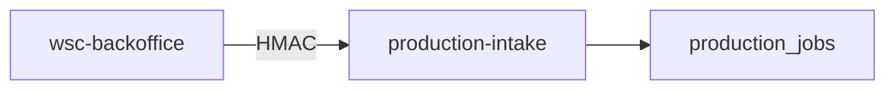
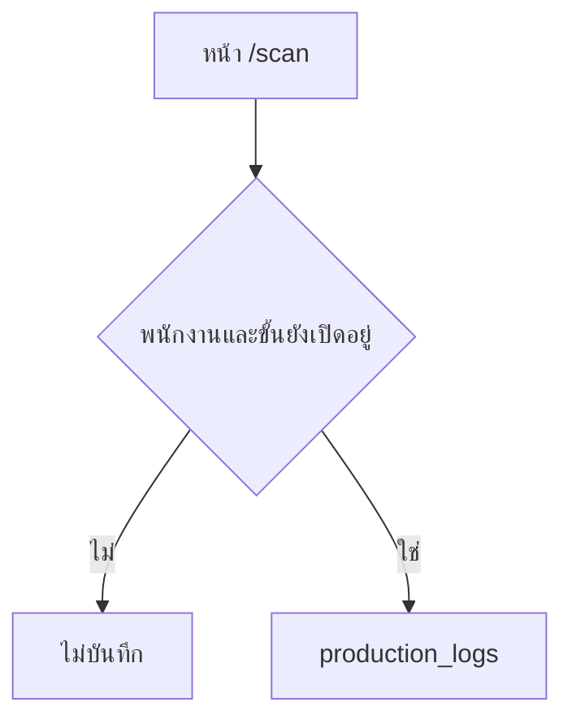
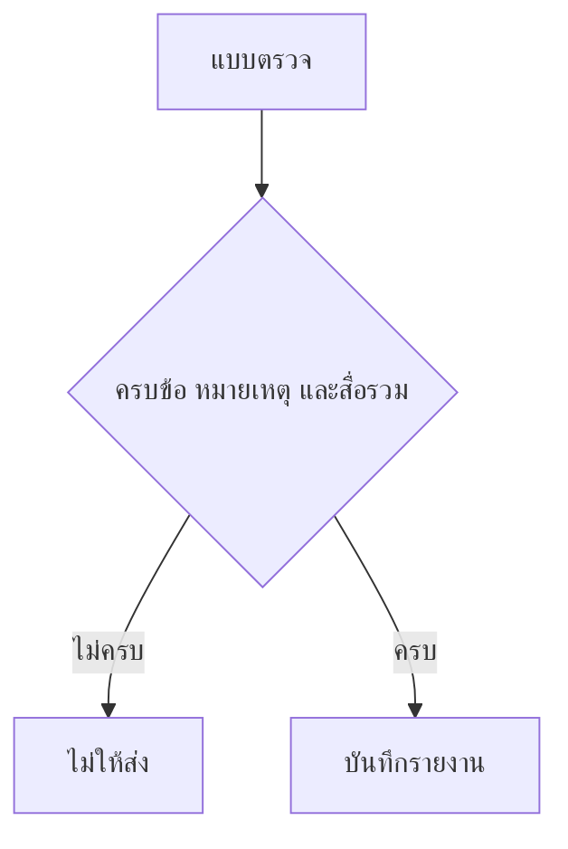

# 03 ขั้นตอนงานที่ตรวจจากโค้ด

| รายการ | ค่า |
| --- | --- |
| Document ID | DISC-03 |
| Document Title | ขั้นตอนงาน |
| Project Name | WSC Production Track |
| Version | 0.1 |
| Created Date | 3 พฤศจิกายน 2026 |
| Prepared By | ที่ปรึกษาจัดทำจากซอร์ส |
| Reviewed By | PENDING HUMAN INPUT |
| Approved By | PENDING HUMAN INPUT |
| Document Status | DRAFT |

## Revision History

| Version | Date | Description | Approved By |
| --- | --- | --- | --- |
| 0.1 | 3 พฤศจิกายน 2026 | ร่างจากฟังก์ชันที่อ่านได้ | PENDING HUMAN INPUT |

ขั้นตอนด้านล่างเป็นพฤติกรรมที่อ่านจากโค้ด (Inferred Current Behavior) ยังไม่มีเอกสารความต้องการต้นฉบับที่ผู้ใช้ลงนาม

## 1. รับงานเข้าคิว

`POST /api/public/production-intake` รับร่างงานที่ backoffice ส่งมา ตรวจลายเซ็น HMAC แล้วจึงเขียนข้อมูล รายละเอียดฟิลด์อยู่ใน `src/routes/api/public/production-intake.ts`

จุดที่คนในโรงงานสร้างใบงานด้วยมือเป็น **NOT VERIFIED**

## 2. สแกนงานผลิต

`submitProductionLog` รับ `job_id`, พนักงาน, ขั้น, หมวด และแอ็กชัน `start` หรือ `finish` จากนั้นตรวจว่าพนักงานและขั้นยังใช้งานอยู่ แล้ว insert `production_logs`

หลักฐาน: `src/lib/features/scan.functions.ts`

โน้ตและรูปแนบถูกเก็บเมื่อแอ็กชันเป็น `finish` เท่านั้น ตามโค้ดชุดเดียวกัน

## 3. สแกนทดลอง

`canStartTrial` ใน `src/lib/scan-trial.ts` ไม่ให้เริ่มขั้นถัดไปถ้าขั้นก่อนในเลนยังไม่จบ และไม่ให้เข้าขั้นหลังเลน รวม QC ถ้าเลนยังไม่ครบ มีเทสอัตโนมัติของกฎนี้ใน `src/lib/scan-trial.test.ts`

การผูกกฎนี้กับหน้าสแกนจริง `/scan` เป็นคนละเส้นทาง หน้า `/scan` ใช้ `submitProductionLog` ไม่ได้เรียก `canStartTrial` ในไฟล์ที่อ่าน

## 4. QC และแพ็ค

ทั้งสองทางใช้ `getReportSubmitBlockReason` และ `assertReportSubmitValid`

ส่งรายงานไม่ได้เมื่อยังมีข้อที่ไม่ได้เลือกผ่านหรือไม่ผ่าน ข้อที่ไม่ผ่านไม่มีหมายเหตุ หรือไม่มีสื่อในหลักฐานรวม

คะแนนรวมคำนวณด้วย `checklistOverall` แล้วบันทึก `qc_reports` หรือ `packing_reports`

หลักฐาน: `src/lib/utils/report-media-validation.ts`, `src/lib/features/qc.functions.ts`, `src/lib/features/packing.functions.ts`

## 5. สิ่งที่โค้ดยังไม่บอก

ลำดับจริงบนพื้นโรงงานว่าใครสแกนก่อนใครหลังใบแท็กพิมพ์เมื่อไร เป็น **NOT VERIFIED** มีหน้าพิมพ์แท็กที่ `src/routes/_protected.print-label.$jobNo.tsx` แต่รอบนี้ไม่ได้อ่านทุกเงื่อนไขบนหน้านั้น
