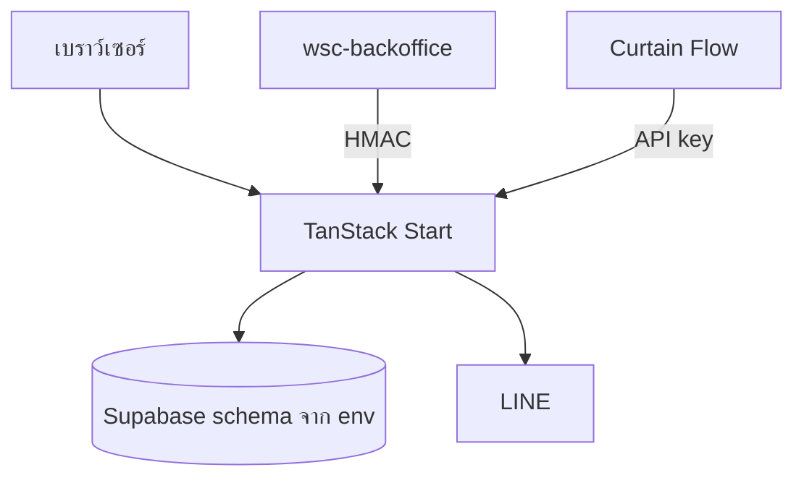

# SI-02 สถาปัตยกรรม

| รายการ | ค่า |
| --- | --- |
| Document ID | SI-02 |
| Document Title | สถาปัตยกรรม |
| Project Name | WSC Production Track |
| Version | 0.1 |
| Created Date | 3 พฤศจิกายน 2026 |
| Prepared By | ที่ปรึกษาจัดทำจากซอร์ส |
| Reviewed By | PENDING HUMAN INPUT |
| Approved By | PENDING HUMAN INPUT |
| Document Status | DRAFT |

## Revision History

| Version | Date | Description | Approved By |
| --- | --- | --- | --- |
| 0.1 | 3 พฤศจิกายน 2026 | ร่างจากโครงไฟล์ | PENDING HUMAN INPUT |

## Overview

แอปเดียวให้ทั้งหน้าเว็บและตัวจัดการคำขอบน TanStack Start build ด้วย Vite แล้วส่งขึ้น Vercel ตาม `vercel.json`

ลูกศรไป LINE มีโค้ดเรียกใน `src/lib/integrations/line.server.ts` ที่ route รายวันอ้างถึง การส่งสำเร็จรายวันเป็น NOT VERIFIED

## Stack

ดู DISC-01

## Auth flow

หน้าแอดมินเก็บโทเคนชื่อ `ptrack_admin_token` ใน sessionStorage หน้างานแผนกมีไฟล์โทเคนแยกใน `src/lib/auth/`

การออกโทเคนใช้ความลับจากสภาพแวดล้อม เอกสารนี้ไม่บันทึกค่าความลับ

## Data flow ของงานผลิต

เบราว์เซอร์เรียก server function แล้ว server function เขียนผ่าน `supabaseAdmin` ที่ตั้ง schema ตาม `SUPABASE_SCHEMA`

## Error handling

ข้อความผิดพลาดที่ผู้ใช้เห็นมาจาก `throw new Error` ใน server function บันทึก `error_logs` มีตารางในไทป์ การเขียน log ทุกจุดเป็น NOT VERIFIED

## Deployment

`vercel.json` กำหนด region `sin1` และหน่วยความจำ build 8192 MB เอกสาร `docs/DEPLOY-VERCEL.md` บอกคำสั่ง build

หมายเลข deployment ที่กำลังให้บริการเป็น NOT VERIFIED

## Security boundary

ความลับอยู่ฝั่งเซิร์ฟเวอร์โดยชื่อตัวแปรไม่มี prefix `VITE_` ตามคำแนะนำใน `docs/DEPLOY-VERCEL.md` ยกเว้นตัวแปรที่ไฟล์ตัวอย่างตั้งใจให้ฝั่งเบราว์เซอร์อ่าน รายชื่ออยู่ใน `.env.example` ไม่คัดลอกค่า
